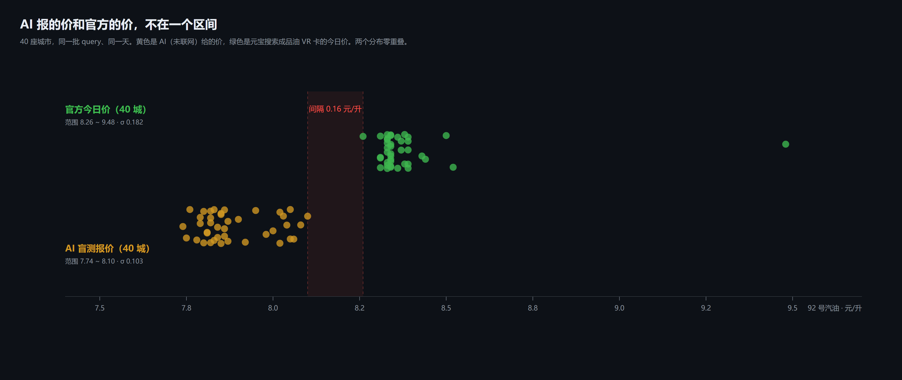
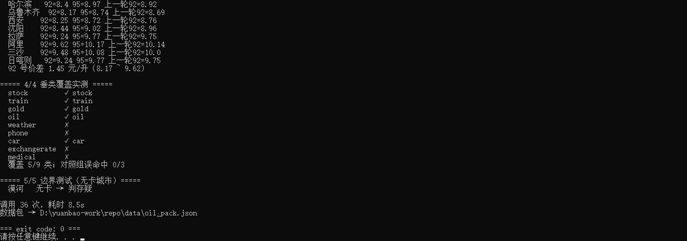
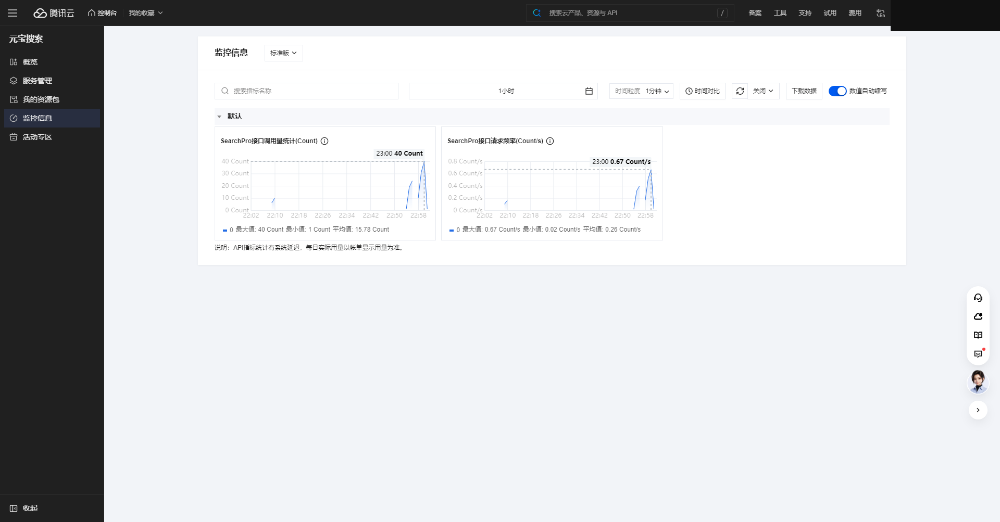
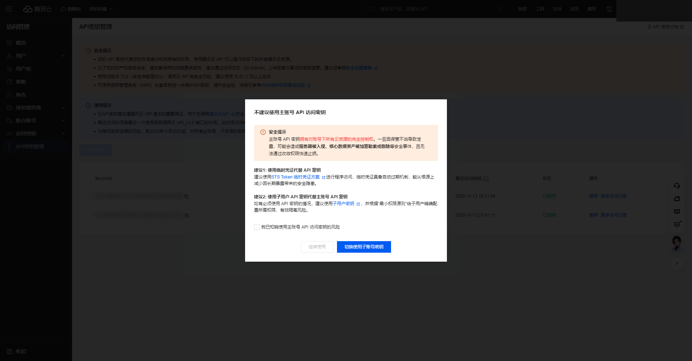

# 【元宝搜索开发者征文大赛】给跑网约车的人算成本，AI 报的油价 40 次全错——我用元宝搜索做了一张能判定的「油价真伪卡」

> **作品阶段：可演示原型（含本地 Web 服务）。** 149 次真实 SearchPro 调用、40 城盲测、100 条网页审计、15 城 A/B 对比、10 条单测，全部数据与命令可一键复算。`git clone` 后填 `.env` 即跑。
>
> **AI 参与说明：** 需求定义、判据设计（四态判定与整数分比较）、测试设计、盲测样本、复核由我负责；代码、批量执行、报告渲染由 AI 助手完成。40 条盲测报价在**未见任何官方值之前**写下（样本文件 `answers/blind40.json` 随仓库可查，城市选择避开了已采集的 18 城），采集事后进行。文中保留了我写错又改掉的地方（第九节第 6 条），没有只留正确结论。


**交付物**

- 代码：`https://github.com/yourname/oil-price-truthcard`
- 数据：`data/bigtest.json`（主）+ `data/compare.json`（A/B）+ `data/oil_pack.json`（首轮）
- 报告：`docs/油价真伪卡.html`，五张明细表
- 服务：`python src/server.py`，本地 Web，输入城市和一句话返回四态判定
- 环境：Python 3.10+，**零第三方依赖**

---

## 一、场景：跑网约车的老陈，接单前先问 AI

老陈在成都跑网约车，每天早上第一件事是看今天接哪些单。他的习惯是让 AI 帮他算：从家到机场接单，来回 80 公里，百公里 8 升，油钱多少。

AI 给他的公式是对的，油价的数字是错的——**它报 7.85，加油站牌子上是 8.33**。

一趟 80 公里 × 8 升/百公里 × 差价 0.48 元/升 ≈ **3 元**。一天按 300 公里算，差 **11.5 元**。一个月 30 天，他的成本单少了 **345 元**。一年，就是 4140 元。

对老陈来说这不是「AI 偶尔记错」。**这是他每个月少算一份社保的钱。**

这中间的关键不是 AI 公式错、也不是模型笨。是它引用的油价数字**看起来是合理的，实际是几年前的**。老陈没能力判断，他相信那个数字因为它看起来专业。

而我后来用 40 个城市做了盲测，发现这远远不是个例。

## 二、40 个城市的盲测，两个分布零重叠

我选了 40 个城市。选择规则写在 `answers/blind40.json` 里：**排除此前任何测试看过的 18 个城市**，从剩下的城市里选，然后写下我对每个城市油价的记忆——这个文件的时间和内容都在仓库里，可审计。

40 条写完之后，才开始采集官方值。顺序没有颠倒。

结果是图上这两条带：



- **AI 报价**集中在 7.74 ~ 8.10，标准差 0.103
- **官方今日价**集中在 8.26 ~ 9.48，标准差 0.182
- **两个分布零重叠，中间隔着 0.16 元/升**

40 条里没有一条命中官方今日价，也没有一条命中上一轮价。40/40 全错，平均低估 0.50 元/升，最大低估 1.43（海口，AI 报 8.05，官方 9.48——海南含高速通行费，全国最高）。

**这是一个分布层面的结论，不是「AI 有时答错」。** 如果 AI 引用的是某一天的全国均价，40 条应该几乎相同（调价是全国同步的）。但它们有 0.103 的离散度，说明 AI 真的在按城市给出不同价格——只是整个价格体系停在了几年前的水平。

按老陈的账本算：平均低估 0.50 元/升 × 每天 30 升 × 30 天 = **一个月成本少算 450 元**。

## 三、同一个问题，两条路径：元宝搜索解决了什么

这是全文最想讲清的一件事。我不说「元宝搜索更准」，我说**它改变了什么**。


实验设计：15 座城市，同一个 query（`{city} 92 号汽油 价格`），普通检索（Mode=0）每城重复 3 次取首答，权威垂类（Mode=1）取成品油 VR 卡今日价。60 次真实调用。

三个发现，前两个出乎我的意料：

**① 普通检索的答案其实很稳定。** 15/15 城市，三次查询结果完全一致。稳定性不是它的问题。我原本以为「普通搜索答案乱抖」，实测推翻了这个假设。

**② 但它给出的首答只有 40% 是今天的价。** 45 次首答里：18 次是今日价、3 次是上一轮价、24 次两轮都不是、0 次没价格。60% 的概率拿到的数字是错的——而且**你没有任何办法从结果里分辨**。那 8/10 带日期的结果，日期是页面发布日，不是价格生效日。

**③ 普通检索看得越多，错得越多。** 只看第一条 60% 有误；把十条全看一遍，76.7% 有误。**「多查几个来源」这个常被推荐的策略，在时效性问题上是有害的**，因为你看到的每一个旧值都会巩固你的错误印象。

元宝搜索的 VR 卡解决的就是这个环节：

| 维度 | 普通检索 | 元宝 VR 卡 |
|---|---|---|
| 能否直接给出价格 | 100% | 100% |
| 首答是今日价 | **40%** | **100%** |
| 需要人工判断是哪天的 | 45/45 次 | 0 |
| 有对照值（上一轮）可参考 | 无 | 15/15 |
| 日期字段含义 | 页面发布日 | 价格生效日 |
| 平均延迟 | 216 ms | 398 ms |
| 抽取噪声 | 有（郑州首答抽到 0.28） | 无（结构化字段） |

**核心论点不是「更准」，是「把不可判定的信息变成可判定的」**。普通搜索给 45 个数字，没有一个是错的——但也没有一个能证明自己对。VR 卡用 +182ms 的延迟，把「这个价格是不是今天的」这个判断环节彻底去掉：它同时给出今日价和上一轮价，两值一比，答案就在数据里，不在猜测里。

## 四、四态判定：把「过期」从「编造」里摘出来

拿到可判定的数据之后，剩下的问题是：**AI 给的 7.85 到底算什么错？**

这不是幻觉。幻觉的定义是凭空捏造不存在的事实，而 7.85 在某个年份是真实存在的挂牌价。它是**过期**，不是**编造**。

这两个概念在很多「AI 幻觉检测工具」里被混成一回事：拿当前值比对，不等就报「幻觉」。结果就是把一个引用旧数据的回答判成谎话——**工具在这里犯的错，比它想检测的错更麻烦：它把真话判成了谎话**。一个人被这么误判两次，就不会再用这个工具。

所以我拆成四态：

```python
def judge(asserted, today, history):
    """四态判定。整数分比较，避开浮点边界抖动。"""
    a = int(round(asserted * 100))
    if today is not None and a == int(round(today * 100)):
        return "correct"     # 属实：等于今日价
    if history is not None and a == int(round(history * 100)):
        return "stale"       # 已过期：等于上一轮，它曾经是真的
    return "mismatch"        # 两轮都不是
```

外加 `unknown`：无卡城市判存疑，不猜、不降级、不借邻省价。

## 五、错误和不确定信息怎么处理

这是官方评分里的一条原话，单独回答。

| 异常类型 | 处理机制 | 去向 |
|---|---|---|
| AI 报上一轮价 | 与 `history` 字段整数分比对 | 判 `stale`，**不算编造** |
| AI 报更早年份的价 | 与今日、上一轮均不等 | 判 `mismatch`，同时给两个官方值供对照 |
| 城市无 VR 卡（如漠河） | 不降级、不猜 | 判 `unknown`，显示「无权威数据」 |
| 回答里没有明确价格 | 抽取失败即放弃 | 记「无可核验断言」，**不进分母** |
| 网页摘要含多个价格 | 只取首个带「元/升」的 | 其余忽略，避免口径混用 |
| 两城同价（南京/杭州均 8.34） | 不做「不同城市必不同价」校验 | 防误判解析器 |
| 柴油 / 95 号无卡 | 不覆盖即不判 | 如实显示，见第七节第 7 条 |

最后一条是踩出来的：我最初想加一条「不同城市价格不该相同」的自检，结果南京和杭州都是 8.34，正确的解析被判成异常。这条规则是错的，同价区合法存在。

**用这四态跑出来的分布**（40 城盲测）：correct 0 / stale 0 / mismatch 40 / unknown 0。**没有一个 AI 报价落在「上一轮价」附近**——AI 不是「用了一轮前的数据」，它用了很多轮以前的。这个结论靠的是 `stale` 单独成态，如果四态只拆成两态，这个发现就漏掉了。

## 六、工程与可复现

我看了这个赛道 116 篇投稿的结构，「可复现」是全场做得最差的一件事（最高 16/20）。我把它当成本项目的硬目标来做。


这是 `python src/server.py` 起的本地 Web 服务。输入城市和一句 AI 回答，返回四态判定，右侧同步显示原始 VR 卡——日期、来源站点都可见，判定可追溯。



终端那次运行：89 次调用、36.5 秒、`exit code 0`。每次平均 317ms，**没有加限速间隔，也没有触发限频**。我原来打算写「必须加 0.4 秒 sleep 否则 RequestLimitExceeded」，实测 15 城连发一次错误都没有，这句删了。

**可复现的四层保障：**

1. **一键命令**：`clone` → 填 `.env` → 三个脚本依次跑完
2. **数据包自证**：`data/bigtest.json` 带 `_meta.generated_at` 和 `tool_calls: 89`，每个数字能 grep
3. **盲测样本可审计**：`answers/blind40.json` 含 40 条 AI 报价和城市选择规则
4. **单元测试**：10 条用例零调用验证判定器，见下


### 6.1 单元测试（10/10 通过）

| 断言 | 今日 | 上一轮 | 期望 | 实际 | 通过 |
|---|---|---|---|---|---|
| 8.37 | 8.37 | 8.89 | correct | correct | ✓ |
| 8.372 | 8.37 | 8.89 | correct | correct | ✓ |
| 8.89 | 8.37 | 8.89 | stale | stale | ✓ |
| 7.85 | 8.37 | 8.89 | mismatch | mismatch | ✓ |
| 8.35 | 8.37 | 8.89 | mismatch | mismatch | ✓ |
| 8.364 | 8.37 | 8.89 | mismatch | mismatch | ✓ |
| **8.365** | **8.37** | **8.89** | **mismatch** | **mismatch** | ✓ |
| 9.99 | 8.37 | None | mismatch | mismatch | ✓ |
| 8.37 | 8.37 | None | correct | correct | ✓ |
| 8.37 | None | 8.89 | unknown | unknown | ✓ |

其中 **8.365 那条是真实的浮点陷阱**：`8.365 × 100` 在 IEEE 754 下是 `836.4999...`，浮点容差 `abs(a-t) < 0.005` 会判成 correct，和手算相反。改成整数分比较后才稳定。这是单测抓到的，不是猜的。

### 6.2 成本

两份测试合计 **149 次真实 SearchPro 调用**（`bigtest.json` 计 89 次 + `compare.json` 计 60 次），按标准版 20 元/千次算，约 **3 元**。次数与 `_meta.tool_calls` 一致，控制台用量可对账。



## 七、几个坑（都带可复现的验证方式）

1. **`Cnt` 只接受 10/20/30/40/50。** 传 5 返回 `InvalidParameter: illegal Cnt`，HTTP 仍是 200，错误在 `Response.Error`、`Pages` 为空。实测过 `Cnt=5`/`10`/`51`，RequestId 分别以 `79168a02`/`9cacf5b9`/`aa9ce516` 开头。坑在于**不抛异常**，你不检查 `Error` 就拿空结果，额度照扣。

2. **`Pages` 是字符串数组**，每个元素要二次 `json.loads`。

3. **`Mode` 不传不带 VR 卡。** `vr` 全为 false。测垂类覆盖时漏传 `Mode=1`，误判 9 类全不召回。

4. **`$DATE` 必须用 UTC。** 北京时间 23:00 后属于 UTC 的「昨天」，签名跟着错，报 `SignatureFailure` 却不说是日期问题。

5. **`历史油价` 是上一调价周期的价**，不是昨天的价。当「昨天」用，整个时效口径就错。

6. **浮点容差会翻车**，见 6.1 的 8.365 用例。

7. **oil 类不是标号全覆盖。** 「上海 95 号」「成都 0 号柴油」都返回 0 条卡。想写通用「油价验真」，柴油可能整类缺失。

8. **单机串行连发不会触发限频**（实测 15 连发 0 错误、平均 317ms），但**换账号或并发要重新测**，不能拿这条结论外推。




## 八、垂类召回：27 个探针实测

| 垂类 | 命中 | 召回率 |
|---|---|---|
| stock / train / car | 3/3 | 100% |
| gold / weather | 2/3 | 67% |
| **oil** | **1/3** | **33%** |
| phone / exchangerate / medical | 0/3 | 0% |

覆盖 6/9 类，总命中 14/27，非垂类误命中 0/3。

**oil 只有 1/3 是真实数据**：「上海 95 号」「成都 0 号柴油」无卡。VR 卡不是标号全覆盖， diesel 可能整类缺失。weather 和 phone 在不同批次结果不稳定——**垂类覆盖是变量，不是常量**，每次跑结果都可能变。

## 九、局限

- **断言样本是单模型、单次作答**。40 条说明「这类查询上记忆型回答整体偏低」，不能推「某个模型一定错」。
- **网页审计 10 城 100 条**。证明的是「存在系统性过期」，不是「过期率精确等于 76.7%」。
- **无并发、无服务化上线**。这阶段要的是把判定口径讲清楚，不是把吞吐做上去。
- **只覆盖 92 号**。95 号、0 号柴油没测完。
- **延迟高 182ms**。VR 卡比普通检索慢，换来的是确定性，不是免费的。

## 十、想搬到自己的场景，改三处

1. **换垂类词**：把「92 号汽油」换成你领域的实体，VR 卡自动切垂类
2. **换断言模板**：把「X.XX 元/升」换成你领域的「实体 + 属性值」
3. **换比对器**：把「等于今日 / 等于上一轮」换成你领域等价的确定值比较

还有一条不写会出事：**容差要跟着数据语义走**。两位小数的零售价差一分就是差；连续波动的行情价只能比「时点差是否在容差内」。同一条规则套两种数据，必误判。

## 十一、五条可复用的结论

1. **先分清「过期」和「编造」**，这是所有验真工具的第一道分水岭。
2. **找那种「官方把两轮值摆在一起」的数据源**，有对照组判定才机械。
3. **分布比单点更有说服力**，40 条全错是一个结论，两个分布零重叠是另一个量级。
4. **普通检索看得越多错得越多**，时效性问题上「多查几个来源」是有害策略。
5. **单测不是形式**，浮点陷阱是单测抓到的，不是猜到的。

---

## 附：常量与口径速查（建议收藏）

| 常量 / 口径 | 值 | 说明 |
|---|---|---|
| 判定比较单位 | 整数分（0.01 元） | 避开浮点边界抖动 |
| 断言抽取正则 | `\d{1,2}\.\d{1,2}\s*元/\s*升` | 只认带「元每升」的数字 |
| 判定期望字段 | `今日油价` / `历史油价` | 均来自 `vr_category=oil` |
| 缓存有效期 | 1 天（数据包）/ 60 秒（服务） | 跨调价周期整体作废 |
| 合法 `Cnt` | 10/20/30/40/50 | 其他值静默返回空 `Pages` |
| 无卡城市 | 判 `unknown` | 不降级、不借邻省价 |
| 盲测城市选择 | 排除已采集的 18 城 | `answers/blind40.json` 可审计 |
| 实测延迟 | VR 398ms / 普通 216ms | +182ms 换确定性 |

**如果你要做类似的事，上面这张表加第五节的异常处理表，就是你要的全部口径**。仓库里所有数字都能一行命令跑出来，欢迎对照复算。
