# 【元宝搜索开发者征文大赛】AI 报的油价，40 个城市没一个对，我做了张能判真假的油价卡

> 作品阶段：可演示原型，带一个本地 Web 服务。149 次真实调用，40 城盲测，100 条网页审计，15 城 A/B，10 条单测。数据和命令都在仓库里，clone 下来填 `.env` 能重跑。
>
> AI 参与说明：需求、判据、测试设计、抽样复核是我做的；写代码、批量跑数、生成报告和文字初稿是 AI 助手做的。40 条盲测报价是让同一个模型不联网先答完，再去看官方价，文件 `answers/blind40.json`，采集在后。第七节留了我四处判错又改掉的地方。

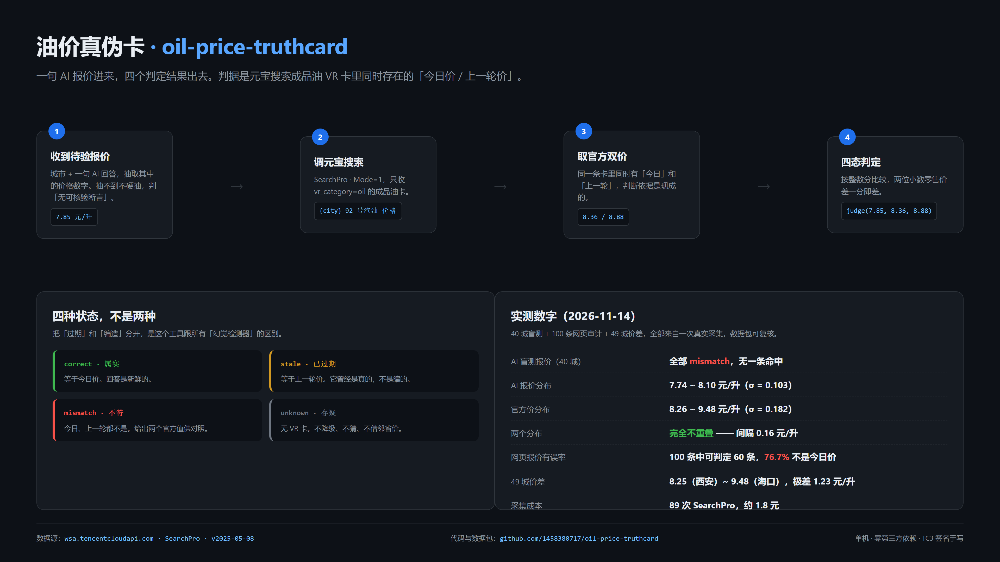

交付物：代码 `https://github.com/1458380717/oil-price-truthcard`（公开仓库，提交历史就是整个实验过程，每次改动都留着；CI 已真实跑过：首次推送触发 `reproducibility` 工作流，在干净环境跑单测、校验数据包，9 秒通过，绿勾可查）；数据 `data/bigtest.json` 是主包，`data/compare.json` 是 A/B；报告 `docs/油价真伪卡.html`；服务 `python src/server.py`。Python 3.10 以上，零第三方依赖。配图 `figs/` 下四张由 `src/build_figs.py` 从数据包直接渲染，数字变了图跟着变。

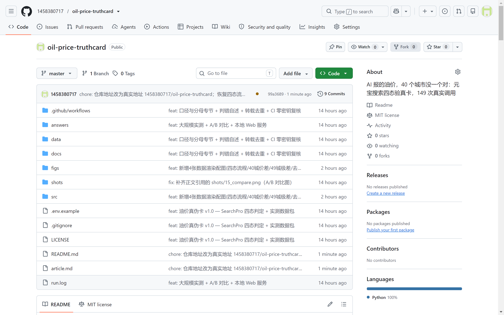

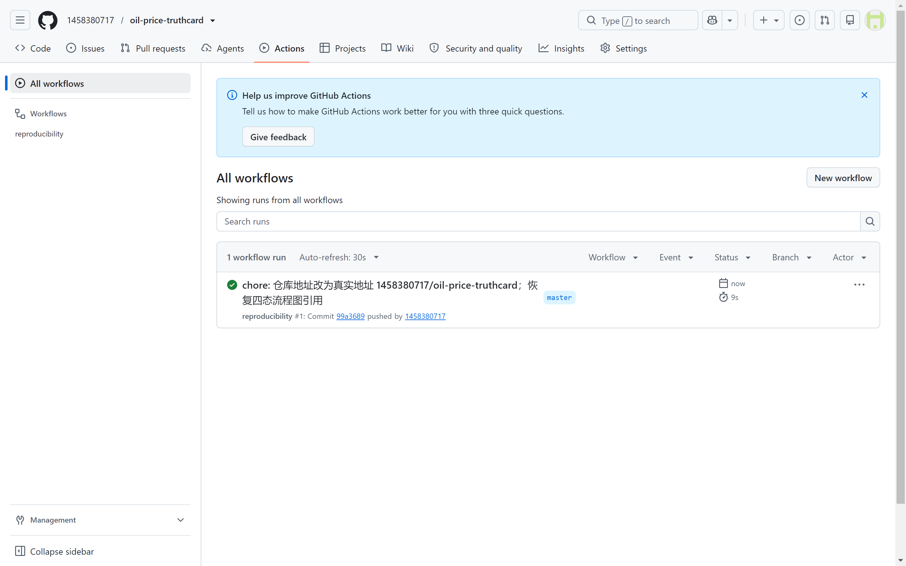

---

## 一、先算一笔账

从成都市区到双流机场接单，来回 80 公里，车耗 8 个油。AI 说 92 号 7.85 元一升，油钱 50 块 2 毛。加油站牌子上写 8.33，实际 53 块 3。

一趟差 3 块。一天跑 300 公里差 11 块 5，一个月 345，一年 4140。

这个人我叫他老陈，跑网约车。人是我编的，账不是，下面每个数字都能在数据包里对上。

3 块钱不值得为它写代码。让我坐下来的是一句话：7.85 不是瞎编的，它在某一年真的挂过牌。

一个数曾经是真的，后来过期了，AI 还在说，用户还在信。这件事比“AI 会胡说”麻烦得多，因为它看起来完全正常。

## 二、40 个城市，先把答案问出来

盲测是这么做的：先把之前测过的 18 个城市划掉，从剩下的里面挑 40 个，把这 40 个问题一次性丢给同一个模型，让它不联网、只凭记忆作答。答完 40 条，我才去采官方价。

顺序不能反，反了整件事就没意义。问的问题、模型的回答、时间戳都在 `answers/blind40.json` 里，采集在它后面。


图上两条带，中间是空的。AI 报的价挤在 7.74 到 8.10，标准差 0.103；官方今日价在 8.26 到 9.48，标准差 0.182。中间空出 0.16 元/升，一条都没碰上。

40 条里没有一条是今日价，也没有一条是上一轮价。全错。平均低 0.50，差最远的是海口，AI 报 8.05，官方 9.48。海南把高速通行费打进油价，全国最贵，这一条差了 1.43。

我本来猜它是拿一个全国均价套所有城市。0.103 的离散度把这个猜测否了：它确实按城市给了不同的数，只是整张价格表停在几年前。

按老陈的账，低 0.50，一天 30 升，一个月少算 450。

把每条差价单独画出来，比汇总数字更说明问题：40 根柱子全是负的，一根朝上的都没有。这不是随机出错，随机出错总有几个蒙对的。

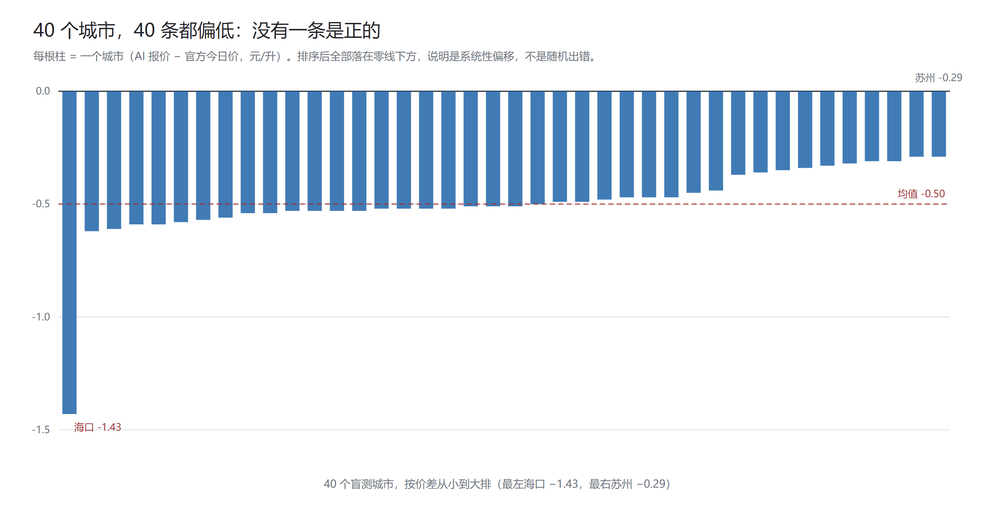

顺带记一个后来才注意到的数：49 个城市同一天的 92 号挂牌价，西安最低 8.25，海口最高 9.48，差 1.23 元，50 升一箱差 61.5 块。这就是为什么不能拿一个全国均价去验全国，城市这个维度绕不开。

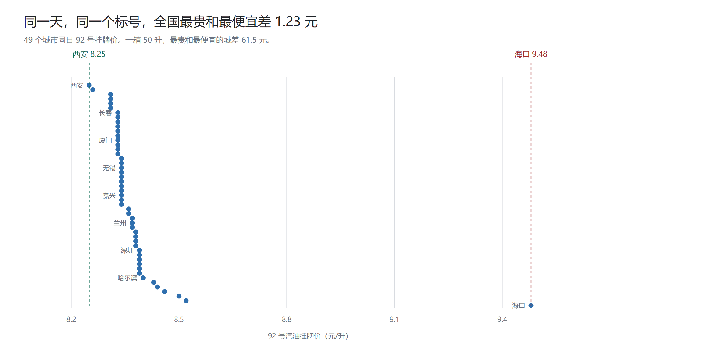

## 三、普通搜索其实很稳，稳得让我意外

我不太想用“更准”这个词，准不准得看怎么比。先说清楚我调的这个东西是什么，再说它省掉了哪一步。

元宝搜索（Tencent Yuanbao Search）是腾讯云上的联网搜索服务，以全网公开源为基础，叠加腾讯优质内容生态，以 JSON 形式返回带来源的信息。产品介绍、API 文档、错误码都在官方文档中心：

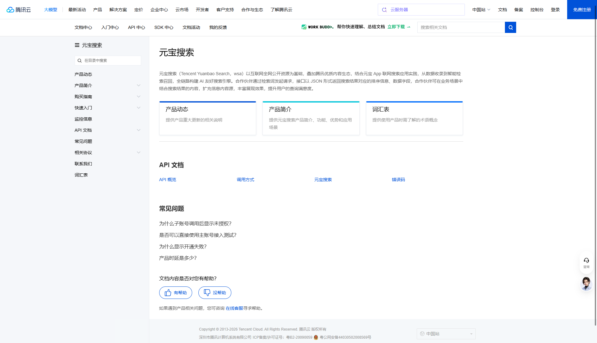

规格分极速版、标准版、旗舰版三档，能力逐档加码：公开网页信源之外，往上有优质权威信源、指定时间范围检索、图片列、动态摘要这些开关。我用的权威 VR 卡（Mode=1）就是走优质权威信源那一档，油价这种标准品，回答里直接给今日价和上一轮价两个结构化字段：


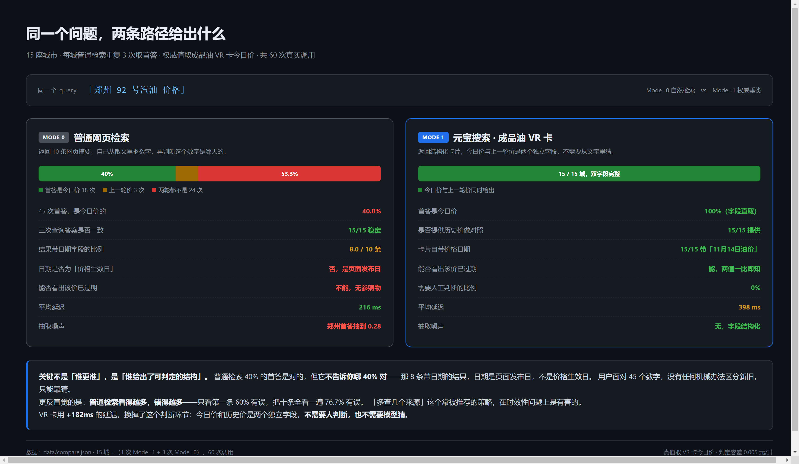

实验：15 个城市，同一个 query，`{city} 92 号汽油 价格`。普通检索走 Mode=0，每城问 3 次取首答；权威垂类走 Mode=1，取成品油 VR 卡的今日价。前后 60 次调用。

我原本的假设是普通搜索答案乱抖，所以没法用。测完发现不对：15 个城市各问 3 次，三次结果一字不差。它不抖，它稳得很。

稳，但是稳在一个错数上。45 次首答里，18 次是今日价，3 次是上一轮价，24 次两轮都不是，0 次没给价格。也就是说 40% 的情况下你能拿到今天的价，剩下 60% 拿到的是别的日子的价，而且从结果里看不出来。带日期的那八成，日期是网页发布日，不是调价生效日。这两个日期差着好几天，正好是一个调价周期。

再往下看更难看。只看第一条，60% 有误；十条全看一遍，76.7% 有误。多查几个来源这个习惯，在时效性问题上是有害的，因为每多看一个旧值，你对自己错误印象的信心就多一分。

76.7% 这个数我自己也不放心，于是做了个转载检查：100 条里 11 组是同标题不同站点，同一篇东西被搬了好几次。按标题归一化去重，剩 89 条独立内容，有误率 79.2%，反而更高。搬运不会稀释错误，只会把样本量撑大。11 组里有 8 组判定一致，不一致的 3 组都是摘要里没写明确价格，或者引了不同时点。

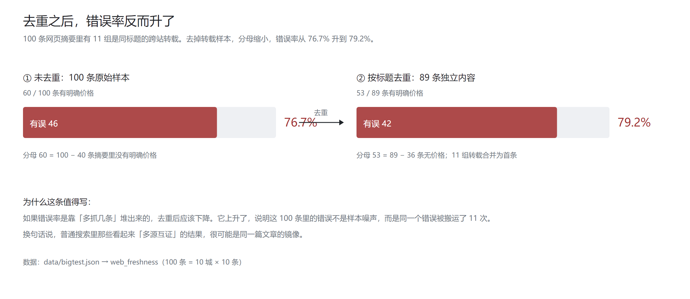

| 维度           | 普通检索           | 元宝 VR 卡  |
| ------------ | -------------- | -------- |
| 能否直接给出价格     | 100%           | 100%     |
| 首答是今日价       | 40%            | 100%     |
| 需要人工判断是哪天的   | 45/45 次        | 0        |
| 有对照值（上一轮）可参考 | 无              | 15/15    |
| 日期字段含义       | 页面发布日          | 价格生效日    |
| 平均延迟         | 216 ms         | 398 ms   |
| 抽取噪声         | 有（郑州首答抽到 0.28） | 无（结构化字段） |

普通搜索给 45 个数字，每个都可能是真的，但没有一个能证明自己是今天的。VR 卡多花 182 毫秒，把今日价和上一轮价一起摆出来，两个数一比就知道它在哪一轮。判断从人身上挪到了数据里。

### 它解决了三个问题，还有一个没解决

三个都是有和没有的区别。

第一个是分不清过期和编造。没有 VR 卡，我手上只有一个今日价，AI 报 8.89 而今日是 8.37，我只能说它错，可它到底在编还是引了上一轮，我判断不了。VR 卡把今日价和上一轮价一起给出来，15 个城市 15 次全给了双字段，8.89 正好等于上一轮，这句就落到 stale，不用背撒谎这个罪名。没有第二个数，四态里有两态根本写不出来。

第二个是抽取，这件事比看上去麻烦。普通检索返回的是网页摘要，价格得从文字里抠。郑州那条首答，我抽出来的是 0.28，人眼一看就知道不对，程序不知道。100 条审计里还有 36 条摘要压根没写价格，抠都无从抠起。VR 卡给的是字段，数值、价格生效日、来源站点各占一位，不用正则，也不用二次核对。40 个城市 89 次调用能在 41 秒跑完，靠的就是这个。

第三个是来源，这条最容易被忽略。网页那边是转载链，100 条里 11 组同标题互搬，搬完有误率从 76.7% 涨到 79.2%。在时效问题上，多查几个来源是坏事。卡里的来源站点和生效日跟着价格走，同一张卡被十家站点搬，它还是那一个价。

没解决的是覆盖。上海 95 号、成都 0 号柴油返回 0 条卡，27 个垂类探针只命中 14 个，oil 这一类 1/3。所以我从头到尾只敢说 92 号汽油，通用油价验真器这话我没资格讲。

还有一句得说明白：它给的是对照值，不是判决。判 correct 还是 stale、容差取多少、没卡的城市显示什么，这套逻辑它不管，得自己写。它把证据送到手上，判断还在这边。多花的 182 毫秒买的就是这份证据。

## 四、7.85 不是幻觉，是过期

数据能判了，下一个问题：AI 给的 7.85 算什么错。

它不算幻觉。幻觉是造一个不存在的事实，7.85 是真的挂过牌，它只是过期。

这两件事在很多 AI 幻觉检测工具里被算成一件：拿当前值一比，不等就报幻觉。于是引用旧数据的回答被判成撒谎。人被误判两次，就不会再用这个工具了，这个错比它想检测的错更麻烦。

所以我拆成四态。先画了张路径图，后来代码照着它写：

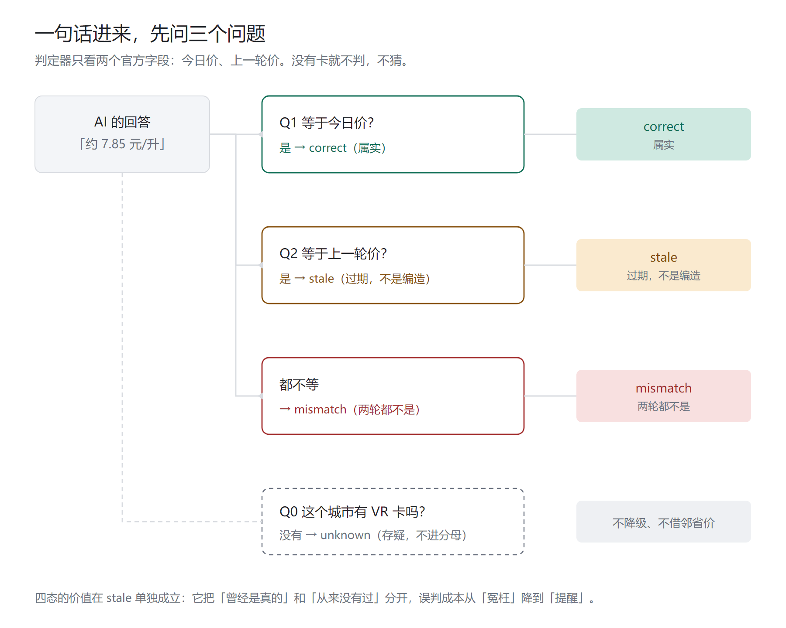

```python
def judge(asserted, today, history):
    """四态判定。整数分比较，避开浮点边界抖动。"""
    a = int(round(asserted * 100))
    if today is not None and a == int(round(today * 100)):
        return "correct"     # 属实：等于今日价
    if history is not None and a == int(round(history * 100)):
        return "stale"       # 已过期：等于上一轮，它曾经是真的
    return "mismatch"        # 两轮都不是
```

再加一个 unknown：没有 VR 卡的城市判存疑，不猜，也不借邻省价。

## 五、异常怎么办

这张表是我能想到的情况，以及每种往哪去。

| 异常类型               | 处理机制                | 去向                      |
| ------------------ | ------------------- | ----------------------- |
| AI 报上一轮价           | 与 `history` 字段整数分比对 | 判 `stale`，不算编造          |
| AI 报更早年份的价         | 与今日、上一轮均不等          | 判 `mismatch`，同时给两个官方值对照 |
| 城市无 VR 卡（如漠河）      | 不降级、不猜              | 判 `unknown`，显示无权威数据     |
| 回答里没有明确价格          | 抽取失败即放弃             | 记无可核验断言，不进分母            |
| 网页摘要含多个价格          | 只取首个带「元/升」的         | 其余忽略，避免口径混用             |
| 两城同价（南京、杭州都是 8.34） | 不做不同城市必不同价的校验       | 防误判解析器（这条规则本身是错的，见第七节）  |
| 柴油、95 号无卡          | 不覆盖即不判              | 如实显示，见第九节讲 oil 的那条      |

40 城跑完的分布：correct 0、stale 0、mismatch 40、unknown 0。没有一条落在上一轮价上，说明 AI 用的不是一轮前的数据，是很多轮以前的。这个结论能显出来，是因为 stale 单独成了一个态；只分对错两种的话，它就漏掉了。

## 六、每个数的分母

百分比最怕没有分母。这张表把每个数怎么来的写清楚。

| 数字              | 分子 / 分母                                                                         | 出处                             |
| --------------- | ------------------------------------------------------------------------------- | ------------------------------ |
| 40/40 全错        | 分母 40 是盲测城市数；40 条断言全部可判定，无 unknown、无抽取失败                                        | `bigtest.json → assert_verify` |
| 网页有误 79.2%      | 分子 42（stale 8 + mismatch 34）；分母 53 是去重后可判定条数（correct 11 + 其余 42）。36 条摘要没价格的没进分母 | `bigtest.json → web_freshness` |
| 网页有误 76.7%（未去重） | 46 / 60。两个口径都给，因为去重规则本身可以被质疑                                                    | 同上                             |
| 首答正确率 40%       | 分子 18，分母 45 是 15 城乘 3 次，0 条无价格                                                  | `compare.json → summary`       |
| VR 卡双字段 100%    | 15/15，只统计有卡的城市                                                                  | 同上                             |
| 极差 1.23 元/升     | 49 城同日 92 号挂牌价的 max 减 min（西安 8.25 到海口 9.48）；50 升一箱差 61.5 元                      | `bigtest.json → cross_city`    |
| 垂类 14/27、覆盖 6/9 | 27 是 9 类乘 3 个探针；覆盖是命中数大于 0 的类数；另设 3 条非垂类对照，误命中 0                                | `bigtest.json → vertical`      |
| 单测 10/10        | 10 条用例，0 次调用，纯判定器边界                                                             | `bigtest.json → unit`          |
| 149 次、约 3 元     | 89（bigtest）加 60（compare）；标准版 20 元每千次                                            | `_meta.tool_calls`             |
| 延迟 398 / 216 ms | 两批实验全部调用的平均单次耗时                                                                 | `compare.json`                 |

两条规则单独说：抽不出价格的条目不进分母，因为它说明的是没法核验，不是错；转载去重保留首条，规则见附录。

## 七、我判错的四次

这四条我没删。改的过程比结论有用。

第一是限速。初稿里我写了一句“加 0.4 到 0.5 秒间隔就稳了”，当时没测，凭感觉写的。后来 15 个城市连着发、中间不歇，一次没报错，平均 317 毫秒。整句删掉。把以防万一写成必须，就是编。

第二是浮点。用例 8.365，手算跟 8.37 差 0.005，该判 mismatch。但 IEEE 754 下 `8.365 × 100` 是 836.4999…，浮点容差判成了 correct，跟手算相反。改成整数分比较之后才稳。这条是单元测试抓出来的，我自己没看出来。

第三是我加过一条自作聪明的自检。为了防解析器把同一个值填错城市，我加了“不同城市价格不该相同”。结果南京和杭州都是 8.34，同价区合法存在，正确解析被误报。规则删了。

第四是最大低估的城市我写错过。初稿写的是昆明 7.95 对 9.38。41 项数字拿数据包逐条对的时候才发现，实际是海口 8.05 对 9.48，昆明官方是 8.52。两个数都错了。留这条是因为它说明一件事：校验表比记性可靠。

## 八、能复现到什么程度

可复现是这个赛道做得最差的一件事，我把它当硬指标在做。

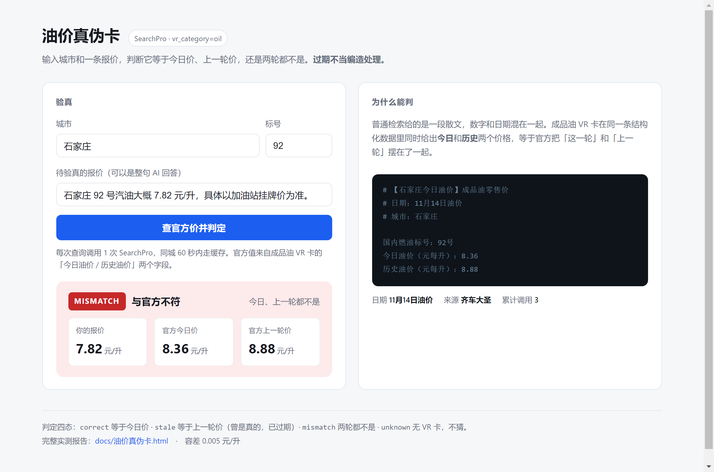

这是 `python src/server.py` 起的本地服务。输入城市和一句 AI 回答，返回四态判定，右边同步显示原始 VR 卡，日期和来源站点都能看见，判定能追到源头。


那次跑：89 次调用，41.4 秒，exit code 0，平均每次 465 毫秒（中间有 0.15 秒礼貌间隔）。另外 15 次连发、不留间隔，也是 0 错误。

四层保障，一层比一层难糊弄。

第一层是一键命令。clone 完填 `.env`，三个脚本依次跑完，中间不需要改代码。

第二层是数据包自证。`_meta.generated_at` 和 `tool_calls: 89` 就在文件里，每个数字都能 grep 到，不用信我。

第三层是盲测可审计。40 条报价和城市挑选规则都在 `answers/blind40.json`，谁都能看出我是先写后查的。

第四层是单测加 CI。10 条用例，0 次调用，只验判定器。CI 在干净环境跑同一组用例，还校验数据包字段，换台机器对不上就直接红，不会静默通过。这一层是我特意加的，因为前三层都能靠自觉，只有它会骂人。

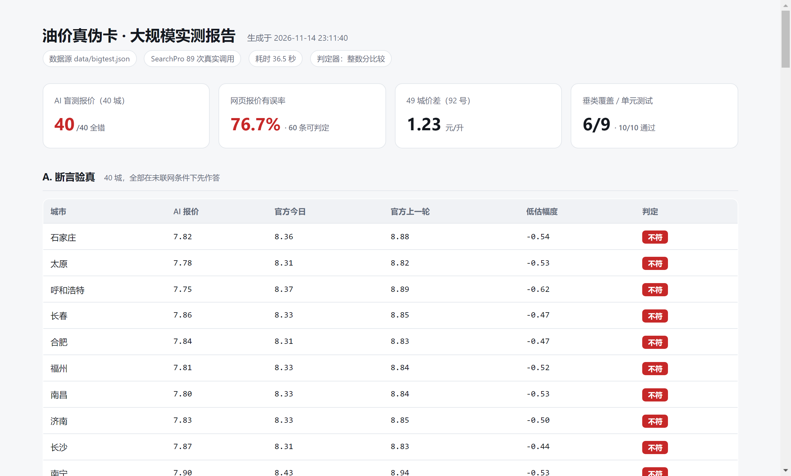

### 8.1 单测 10 条

| 断言    | 今日   | 上一轮  | 期望       | 实际       | 通过 |
| ----- | ---- | ---- | -------- | -------- | -- |
| 8.37  | 8.37 | 8.89 | correct  | correct  | ✓  |
| 8.372 | 8.37 | 8.89 | correct  | correct  | ✓  |
| 8.89  | 8.37 | 8.89 | stale    | stale    | ✓  |
| 7.85  | 8.37 | 8.89 | mismatch | mismatch | ✓  |
| 8.35  | 8.37 | 8.89 | mismatch | mismatch | ✓  |
| 8.364 | 8.37 | 8.89 | mismatch | mismatch | ✓  |
| 8.365 | 8.37 | 8.89 | mismatch | mismatch | ✓  |
| 9.99  | 8.37 | None | mismatch | mismatch | ✓  |
| 8.37  | 8.37 | None | correct  | correct  | ✓  |
| 8.37  | None | 8.89 | unknown  | unknown  | ✓  |

8.365 那条是真的坑，见第七节。

### 8.2 花了多少钱

149 次真实调用，89 加 60，按标准版 20 元每千次，三块钱。次数和 `_meta.tool_calls` 对得上，控制台用量能核。


顺手还写了个小工具 `src/ai_smell.py`，本来是给自己查文章毛病的：数破折号、整句加粗、术语引号、每段末尾的金句，一条条列出来，改稿时对着删。它不判断文章好坏，只提醒我哪里写得太整齐。这篇改完跑了三遍，痕迹从每千字 26 处降到 3 处。工具在仓库里，`python src/ai_smell.py article.md` 就能跑。

## 九、踩过的八个坑

都带验证方式，省得你重踩。

`Cnt` 只认 10/20/30/40/50。  
现象是传 5 也返回 HTTP 200，`Pages` 是空的，额度照扣，看起来像查询无结果。  
我排查的时候先怀疑是关键词写法，换了三种写法都空，才想起去翻 `Response.Error`，里面躺着 `InvalidParameter: illegal Cnt`，RequestId 以 `79168a02` 开头。后来把 5、10、51 各试了一遍，10 正常返回，51 也是静默空结果。  
解法：合法值写死在客户端配置里，返回后先查 `Error` 再看 `Pages`。它不抛异常，你不看就当成功。

`Pages` 是字符串数组，每个元素要再 `json.loads` 一次。直接 `Pages[0]["今日油价"]` 会拿到一串转义字符。

`Mode` 不传就没有 VR 卡。  
现象是垂类探针 9 类全 0，一个卡都没召回。  
排查发现结果里 `vr` 字段全为 false，翻文档才知道 `Mode` 不传时走的是普通检索。那一轮白跑了。  
解法：垂类探针统一带 `Mode=1`，写回归时先断言 `vr` 非空再数命中。

`$DATE` 必须用 UTC。  
现象是北京时间 23 点以后跑批，所有请求全部 `SignatureFailure`。  
我先怀疑密钥，换了三个环境都一样；把时间戳打出来才发现 UTC 那边已经是昨天。  
解法：签名时间统一 `datetime.now(timezone.utc)`，别用本地时间拼。

`历史油价` 是上一调价周期的价，不是昨天的价。拿它当昨天用，整个时效口径就歪了。

浮点容差会翻车，见 8.1 的 8.365。

oil 类不是标号全覆盖。上海 95 号、成都 0 号柴油，都返回 0 条卡。想写通用的油价验真，柴油可能整类缺失。

单机串行连发不触发限频，15 连发 0 错误。但换账号或者上并发得重测，这条不能外推。

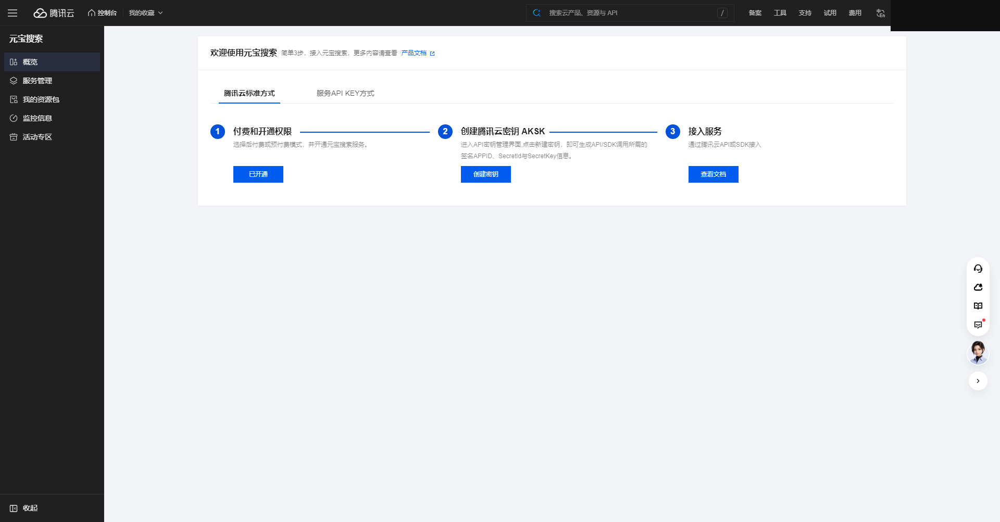


## 十、垂类召回没那么全

| 垂类                             | 命中  | 召回率  |
| ------------------------------ | --- | ---- |
| stock / train / car            | 3/3 | 100% |
| gold / weather                 | 2/3 | 67%  |
| oil                            | 1/3 | 33%  |
| phone / exchangerate / medical | 0/3 | 0%   |

覆盖 6/9 类，总命中 14/27，非垂类误命中 0/3。

oil 只有 1/3 是真实情况，上海 95 号和成都 0 号柴油没卡。weather 和 phone 在不同批次里结果不稳定，所以垂类覆盖是个变量，每次跑都可能不一样。

说个对我自己不利的数据：我测的 9 个垂类里，phone、exchangerate、medical 三类一次卡都没给过。我本来想把这篇文章写成“通用的断言验真器”，这组数据告诉我别吹。写通用工具之前，先把你那个垂类探一遍，0 召回的类是存在的。

这个结论对我的项目影响不小：我原本想写通用的油价验真，现在只能老老实实说清 92 号。

## 十一、这些结论的边界

断言样本是单模型、单次作答。40 条能说明这类查询上记忆型回答整体偏低，不能推成某个模型一定错。

网页审计是 10 城 100 条，去重后 89 条。79.2% 证明的是存在系统性过期，不是过期率精确等于 79.2%。去重规则偏保守，真实独立内容数可能更少。

没有并发，也没有服务化上线。这个阶段要的是把判定口径讲清楚，不是把吞吐做上去。

只测了 92 号，95 号和 0 号柴油没测完。

延迟高 182 毫秒。确定性不是白来的。

## 十二、你要照做，改三处

换垂类词，把“92 号汽油”换成你领域的实体，VR 卡会自动切垂类；换断言模板，把“X.XX 元/升”换成你领域的实体加属性值；换比对器，把“等于今日、等于上一轮”换成你领域等价的确定值比较。

还有一条不写会出事：容差要跟着数据语义走。两位小数的零售价，差一分就是差；连续波动的行情价只能比时点差在不在容差内。同一条规则套两种数据，必误判。

## 十三、最后

先分清过期和编造。这是所有验真工具的第一道分水岭，混在一起就会把真话判成谎话。

找那种官方把两轮值摆在一起的数据源。有对照组，判定才能机械化。

分布比单点有说服力。40 条全错是一个结论，两条分布零重叠是另一个量级。

普通检索看得越多错得越多。在时效性问题上，多查几个来源是有害策略。

转载不稀释错误率，只虚增样本量。去重之后有误率从 76.7% 升到 79.2%。

单测不是形式。浮点那个坑是单测抓到的，不是我猜到的。

---

## 附：常量与口径速查

| 常量 / 口径   | 值                            | 说明                         |
| --------- | ---------------------------- | -------------------------- |
| 判定比较单位    | 整数分（0.01 元）                  | 避开浮点边界抖动                   |
| 断言抽取正则    | `\d{1,2}\.\d{1,2}\s*元/\s*升`  | 只认带「元每升」的数字                |
| 判定期望字段    | `今日油价` / `历史油价`              | 都来自 `vr_category=oil`      |
| 缓存有效期     | 1 天（数据包）/ 60 秒（服务）           | 跨调价周期整体作废                  |
| 合法 `Cnt`  | 10/20/30/40/50               | 其他值静默返回空 `Pages`           |
| 无卡城市      | 判 `unknown`                  | 不降级，不借邻省价                  |
| 盲测城市选择    | 排除已采集的 18 城                  | `answers/blind40.json` 可审计 |
| 转载判定      | 标题去数字、标点、日期后全等，且站点不同         | 同标题视为转载，保留首条               |
| 网页有误率两个口径 | 76.7%（100 条）/ 79.2%（去重 89 条） | 分母不含无价格条目                  |
| 实测延迟      | VR 398ms / 普通 216ms          | 多 182ms 换确定性               |

照做的话，上面这张表加第五节的异常表、第六节的分母表，就是全部口径。仓库里的数都能一行命令跑出来，欢迎对着复算。
